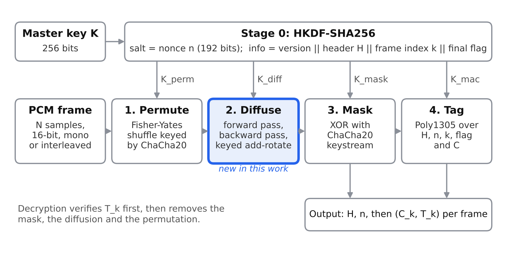
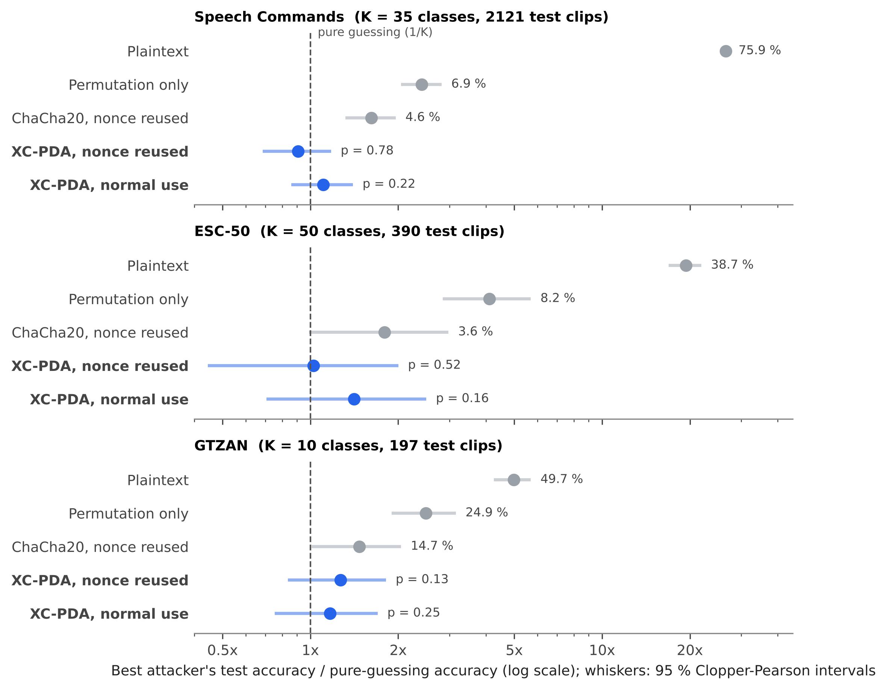

# XC-PDA: ChaCha20-based authenticated encryption for audio

Reference implementation, experiments and raw results for the paper
**"A ChaCha20-Based Permutation-Diffusion Authenticated Cipher with Extended-Nonce Key Derivation for Secure Audio Transmission and Storage"**.

**Authors:** Lakhichand Patil (Fergusson College (Autonomous), Pune, India) and Kalpesh Popat (Marwadi University, Rajkot, India; corresponding author, kapopat@gmail.com).

XC-PDA encrypts 16-bit PCM audio in four keyed stages, each driven by its own subkey from one HKDF-SHA256 call over a 256-bit key and a 192-bit nonce:

1. **Permute** the samples with a ChaCha20-driven Fisher-Yates shuffle.
2. **Diffuse** with a new bidirectional keyed add-rotate chain, so one changed sample changes the whole frame.
3. **Mask** with a ChaCha20 keystream (this stage carries the confidentiality proof).
4. **Tag** with Poly1305 over the header, nonce, frame index, final-frame flag and ciphertext.



> **Status:** research prototype accompanying a paper under review. It has not been independently audited. Do not use it to protect real data without review; for production systems use a standard AEAD such as XChaCha20-Poly1305, or AES-GCM-SIV where nonce-misuse resistance is needed.
>
> **Known limitation:** XC-PDA is **not** nonce-misuse resistant. If a nonce is repeated, related plaintexts expose a deterministic carry relation of the add-rotate diffusion (paper, Section 6.6; `experiments/run_strengthening_experiments.py`, E2). Always use a fresh random 192-bit nonce, as the API does by default.

## Quick start

```bash
git clone https://github.com/kapopat1980/xcpda-audio-cipher.git
cd xcpda-audio-cipher
pip install -r requirements.txt
python -m pytest -q tests                      # 12 tests: round trip, tampering, wrong key, sensitivity, nonce reuse

python -m xcpda keygen key.bin                 # 32 random bytes
python -m xcpda encrypt speech.wav speech.xcpda --key key.bin --frame-seconds 1
python -m xcpda decrypt speech.xcpda restored.wav --key key.bin
```

Python API:

```python
import os, numpy as np
from xcpda import encrypt_audio, decrypt_audio, pack, unpack

key = os.urandom(32)
samples = np.zeros(44100 * 2, dtype=np.int16)          # interleaved 16-bit PCM
blob = encrypt_audio(key, samples, sr=44100, ch=2, chunk=88200)   # 1 s frames; chunk=None = whole file
data = pack(blob)                                       # bytes for storage or transport
restored = decrypt_audio(key, unpack(data))             # raises AuthError if anything was modified
```

## Reproducing the paper

| What | Command | Time |
| --- | --- | --- |
| Tables 2-6, ablation, nonce reuse, tamper detection, throughput | `python experiments/run_local_experiments.py` | about 2 min on one CPU core |
| Figures 1-6 | `python experiments/make_figures.py` (after the line above) | under 1 min |
| Tables 7-9 and the deep-learning leakage attack | `kaggle/xcpda_kaggle.ipynb` on Kaggle with a T4 GPU and the GTZAN, ESC-50 and Speech Commands datasets attached | about 40 min |
| Attack statistics against pure guessing (Table 9, Figure 6) | `python experiments/recompute_attack_stats.py results/kaggle_run2/partB_dl_attack.json` | seconds |
| AES-GCM-SIV baseline, related-plaintext analysis, frame length and channel errors, encrypted silence (Sections 6.6, 6.11, 6.12) | `python experiments/run_strengthening_experiments.py` | under 1 min |
| Throughput against standard AEADs (Table 10) | `python experiments/bench_aead_baselines.py pair_hw_1`, then the same with `OPENSSL_ia32cap="~0x200000200000000:~0x60000000000"` and label `pair_noaes_1` (repeat for 2 ... 5) | 1 min per run |
| Official NIST STS 2.1.2, all 15 tests (Table 6) | `sh experiments/run_nist_sts.sh audio` (and `silence`), then `python experiments/parse_sts.py results/nist_sts/finalAnalysisReport_audio.txt` | about 1.5 h each |

The local experiments use the eight sound clips shipped with LibreOffice (`/usr/lib/libreoffice/share/gallery/sounds`; pass `--gallery` for another location) and two synthetic signals generated with fixed seeds. Every statistic except throughput is deterministic and reproduces the paper exactly.

Kaggle datasets used: [GTZAN](https://www.kaggle.com/datasets/andradaolteanu/gtzan-dataset-music-genre-classification), [ESC-50](https://www.kaggle.com/datasets/mmoreaux/environmental-sound-classification-50), [Speech Commands v0.02](https://www.kaggle.com/datasets/yashdogra/speech-commands).

## Main results

| Test | Result |
| --- | --- |
| Decryption | Bit-exact on all 130 files |
| Byte entropy of ciphertext | 7.9968-7.9999 bits (ten-file corpus) |
| NSCR / UACI, one-LSB plaintext change | at least 99.999 % / 33.3 % (plain ChaCha20: one sample changed) |
| NIST SP 800-22, 9 statistics (in-house) | All passed on 500 + 1,000 sequences of 10^6 bits |
| Official NIST STS 2.1.2, 15 tests | Encrypted audio 187/188 sub-tests, encrypted silence 188/188 (1,000 sequences each) |
| Tampering (1,000 bit flips, frame swap, truncation, header edit) | All detected |
| Nonce reuse, unrelated recordings: positions revealing P1 XOR P2 | ChaCha20 100 %, XC-PDA 0.0035 % (chance) |
| Nonce reuse, related recordings | Carry relation holds at 100 % of predicted positions: **not misuse-resistant** |
| AES-GCM-SIV baseline | Same plaintext sensitivity, provably misuse-resistant, 5.1x faster with AES hardware, 1.4x faster with AES instructions disabled |
| 20 ms frames | 0.13 ms per frame; 99 % of audio kept at 1 % packet loss |
| CNN attack on ciphertext (3 datasets, 18 tests) | No result above pure guessing (smallest p = 0.13) |
| Throughput, one CPU core | 25-93 MB/s, at least 114x real time for CD-quality stereo |



## Repository layout

```
xcpda/            cipher (cipher.py), file format (pack/unpack), command-line tool (__main__.py)
tests/            pytest suite
experiments/      local experiments, NIST SP 800-22 subset, figure script, attack statistics
kaggle/           GPU notebook for the standard datasets and the leakage attack
results/          raw results behind every table and figure (see results/README.md)
figures/          the six figures of the paper at 300 dpi
```

## File format

`b"XCPDA1"` (6 B) | header (20 B: sample rate, channels, bit depth, total samples, frame length) | nonce (24 B) | for each frame: ciphertext (2 B per sample) followed by a 16-byte Poly1305 tag. Overhead is 50 bytes plus 16 bytes per frame.

## Citation

See `CITATION.cff`. Please cite the paper once published.

## License

MIT, see `LICENSE`.
